# 株式会社ネクサス様　伝票発行アプリ　スタート・運用ガイド

対象アプリ：株式会社ネクサス様　伝票発行アプリ  
URL：〔例：https://pv-dn.github.io/purims/ 〕

導入当日〜最初の1週間と、日常の使い方を画面つきで説明します。  
アプリ内の「使い方・困ったとき」タブと合わせて使ってください。  
（内容更新：2026-10-30／ロット・台帳受け渡し・請求タブを反映）

---

## 1. はじめに

### できること
- 客先ごとの納品伝票を発行・印刷
- 発行履歴の確認・再印刷・訂正再発行
- 客先・品目・納品サイクルのマスタ管理
- 入出荷台帳との連動（ロット番号の反映など）
- 請求明細書・請求一覧
- クラウド自動保存（別PCでも同じデータ）

### 含まれないもの（別相談）
- 見積書・領収書、大規模な画面レイアウト変更 … 別途相談

### データの置き場所（クラウド）
- **Firebase（ファイアベース）とは** … Googleのインターネット上のデータ置き場です。  
  客先・品目・履歴などをここに置くので、別のPCで開いても同じ内容が出ます。普段はアプリを使うだけでよく、Firebaseの管理画面は触らなくて大丈夫です。  
- **導入当初** … 提供者側が用意した Firebase に自動保存します。  
  御社で Firebase のアカウント登録は不要です。URLとログインパスワードがあれば使えます。  
- **あとで移す場合** … 御社の Firebase へデータを移し、接続先を切り替えできます（時期・費用は都度相談）。  
- **手元の保険** … データタブの「JSONバックアップ」を週1など定期でPCに保存してください。

---

## 2. ログイン画面

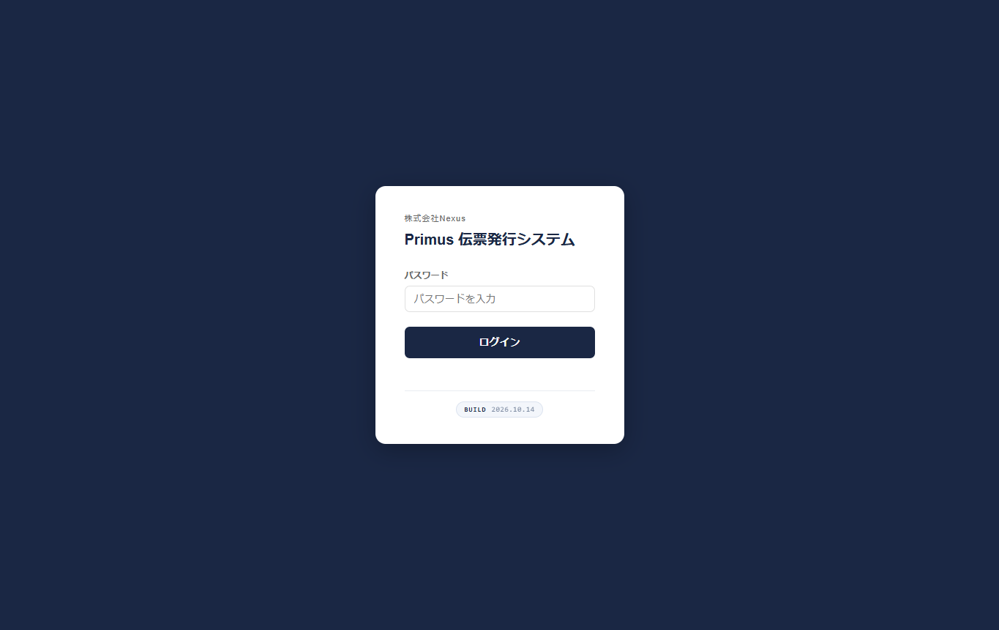

| ここ | 意味 |
|---|---|
| パスワード | 利用者ごとに決まっているログイン用パス |
| ログイン | 押すとアプリが開く |

**手順：** URLを開く → パスワード入力 → **ログイン**

**初期パスワード：** デフォルトで登録されているユーザーのパスワードは `admin1234` です。  
導入後は、必要に応じてユーザー管理から変更してください。

---

## 3. 導入当日チェックリスト

### A. 開けること
- [ ] URLをブックマーク（またはアプリとしてインストール）
- [ ] ログインできる
- [ ] 画面に自分の名前が出る

### B. 最初に決めること
- [ ] 管理者アカウントと一般ユーザーを分けた（→ **14. ユーザー管理**）
- [ ] 管理者パスワードを受け取った／変更した
- [ ] 現場用の一般ユーザーを追加した
- [ ] 履歴の保存期間（3／6／12か月）→ 初期は **6か月** 推奨
- [ ] 「請求系マスタ項目」は原則 **OFF**
- [ ] データタブの「伝票フッターの会社名」に会社名・住所・連絡先を入れた

### C. マスタ準備
- [ ] 客先・品目・納品サイクルを登録
- [ ] 必要ならグループ（＝伝票のルート番号）・記号を設定
- [ ] ロット番号を付けてテスト発行〜印刷までできた
- [ ] （使う場合）請求系マスタをONにして単価・締め日を入れ、請求タブを確認した
- [ ] 台帳から「伝票を発行」→ 伝票側に数量が入ることを確認した

### D. 印刷設定
- [ ] 用紙：**B5 横向き**
- [ ] 倍率：**100%**
- [ ] 余白：**なし／最小**

---

## 4. 伝票発行（トップ）

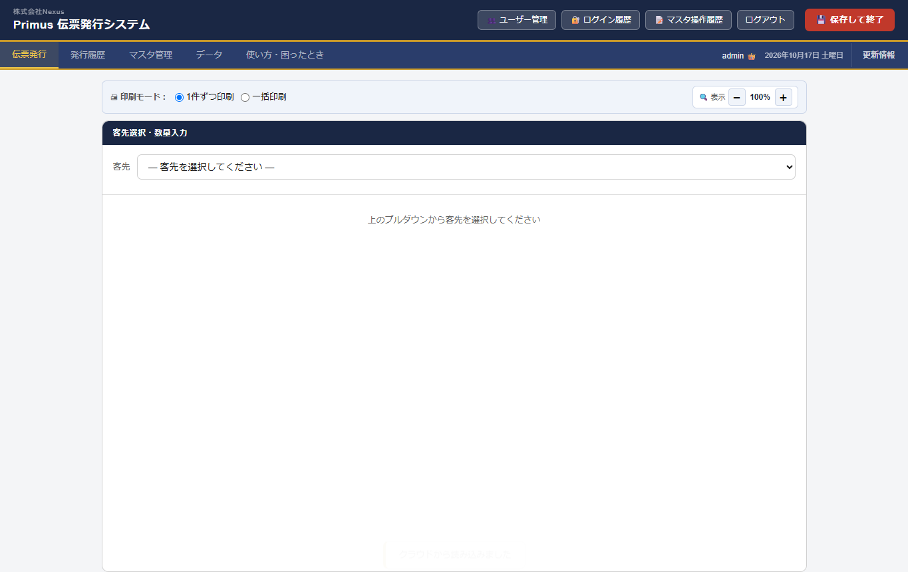

最初に開く画面です。まだ客先を選んでいない状態。

| 場所 | 説明 |
|---|---|
| 印刷モード | **1件ずつ**＝発行のたびに印刷／**一括**＝貯めてまとめて印刷 |
| 客先プルダウン | ここから開始 |
| 表示（±） | 画面の拡大縮小（印刷サイズとは別） |
| ヘッダー右 | ユーザー管理・履歴・ログアウト・保存して終了 |
| タブ右端 | ログイン名 → 日付 → 更新情報 |

---

## 5. 伝票発行（数量入力）

客先を選ぶと、この入力画面になります。

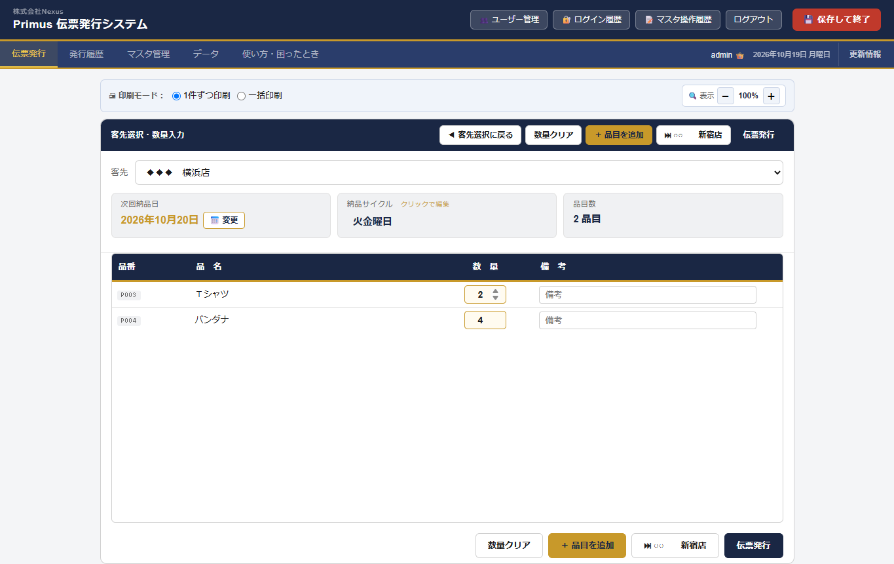

| 場所 | 説明 |
|---|---|
| 客先 | 選んだ届け先 |
| 次回納品日 | サイクルから自動。**変更**で日付指定も可 |
| 納品サイクル | 納品曜日。クリックで編集可 |
| 品目数 | この客先に登録されている品目の数 |
| **ロット番号** | 荷造り照合用（1〜10）。台帳から受け取ったときもここに入る |
| 品番／品名 | マスタから出る一覧 |
| 数量 | ここに数字を入れる（本日の出荷数） |
| 備考 | 任意。伝票に出せるメモ |
| 数量クリア | 入力した数量を全部消す |
| ＋品目を追加 | 今日だけ追加の品目（マスタ／自由入力） |
| **伝票発行** | 履歴に保存し、完了画面へ進む |

### 操作の流れ
1. 客先を選ぶ  
2. 必要なら **ロット番号** を選ぶ（台帳から来た場合は入っている）  
3. 数量を入れる（出さない品目は 0 のまま）  
4. 必要なら納品日を変更  
5. **伝票発行** を押す  
6. 完了画面で **客先・納品日・ロット・品目数・合計点数** を確認する  
7. **印刷する** → ブラウザの印刷画面で紙のイメージを確認してから印刷  
   （同じロットの伝票をまとめて印刷するボタンも出ることがあります）

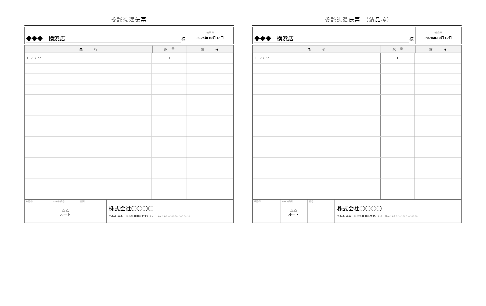

**印刷の目安（右側の設定）**
- 用紙サイズ：**B5**
- 余白：**なし**（または最小）
- 倍率：**100%**（規定のままでも可。小さく出るときは100%にする）

※アプリ内に「紙面プレビュー専用」の画面はありません。伝票の見た目は、この印刷画面で確認します。

### 同一納品日ロック（重要）

**同じ客先 × 同じ納品日** の伝票が履歴に既にあるとき、発行ボタンを押すと確認が2回出ます。

**1回目（おすすめ）**  
「訂正して再発行しますか？」

- **OK** … 既存の履歴を直して出し直す（数量ミスなどの修正向き）  
- **キャンセル** … 次の確認へ  

**2回目**  
「同じ納品日で、新しい伝票として発行しますか？」

- **OK** … 同じ納品日でもう1件、新規発行する（履歴が2件になる）  
- **キャンセル** … 発行しない  

基本は **訂正再発行** を使います。  
どうしても同じ納品日で別伝票が必要なときだけ、2回目で新規発行を選んでください。

---

## 6. 発行履歴

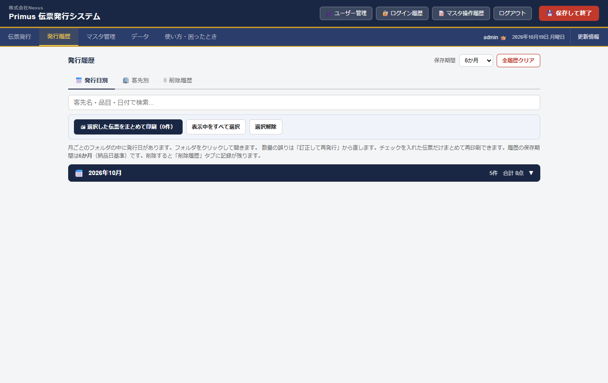

| 場所 | 説明 |
|---|---|
| 発行日別／客先別／**ロット別**／削除履歴 | 見方の切り替え |
| 検索 | 客先名・品目・日付・ロットで絞り込み |
| 保存期間 | 何か月残すか（3／6／12） |
| フォルダ | 月→日付の入れ子。クリックで開く |
| チェック | 選んだ伝票だけまとめて再印刷 |
| ロットまとめて印刷 | 同じロット番号の伝票をまとめて再印刷 |
| 訂正して再発行 | 数量ミスなどを直して同じ履歴を更新 |

---

## 6b. 入出荷台帳からの受け渡し

台帳アプリ（`https://pv-dn.github.io/pourvous-ledger/`）で数量を入れたあと:

1. 台帳で **ロット番号** を選ぶ  
2. 客先・数量を入力  
3. **伝票を発行** を押す → 伝票アプリが開く  
4. 伝票側でログインすると、客先・数量・ロットが入る  
5. 内容を確認して、いつもどおり伝票発行・印刷  

同じブラウザで開くと受け渡しがスムーズです。

---

## 6c. 請求タブ

上部タブの **請求** から、請求明細書・請求額一覧の確認・印刷・Excel出力ができます。

| 操作 | 内容 |
|---|---|
| 請求月 | 年・月を指定 |
| 請求明細書を見る | 客先ごとの明細を画面で確認・印刷 |
| 請求額一覧を見る | 一覧表を確認・CSV／Excel |
| 未反映分を見る | まだ請求Excelに出していない伝票 |

※締め日・単価・配送費などは、**データ**タブの「請求系マスタ項目」をONにしてからマスタで設定します（初期はOFF）。

---

## 7. マスタ管理（入るとき）

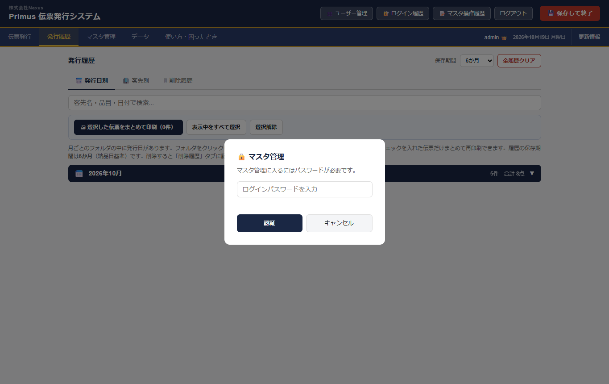

マスタは大事なデータなので、開くときにパスワード再入力があります。  
ログインと同じパスワードを入れ、**認証**を押します。

---

## 8. マスタ：客先を選ぶ

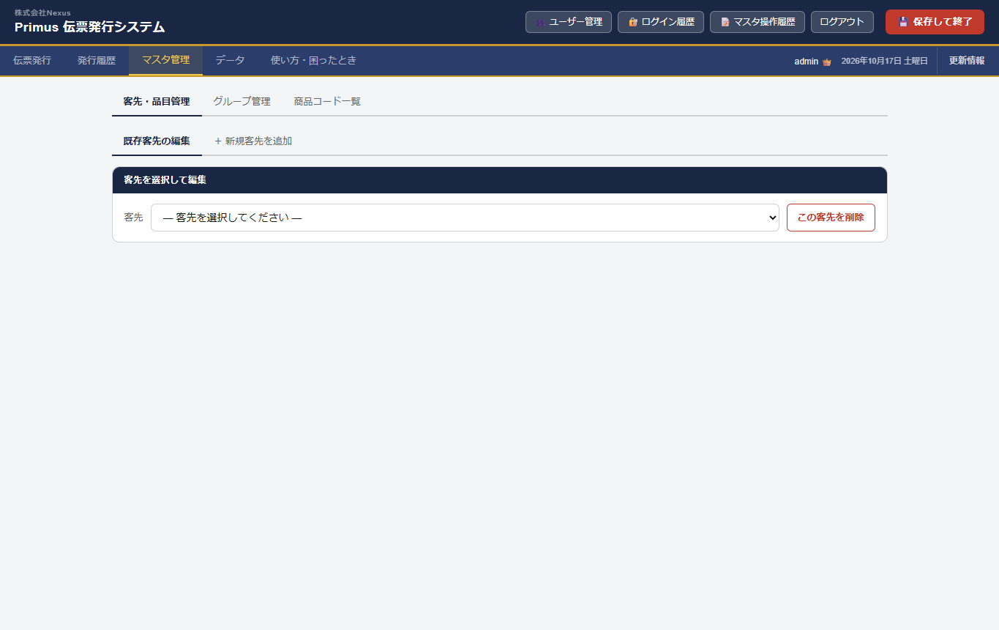

| タブ | 用途 |
|---|---|
| 客先・品目管理 | 普段いちばん使う |
| グループ管理 | ルートなどのまとめ |
| 商品コード一覧 | 品目マスタ全体 |

客先・品目では：

- **既存客先の編集** … いまある客先を直す  
- **＋ 新規客先を追加** … 新しい届け先を作る  

---

## 9. マスタ：基本情報の編集

客先を選ぶと、基本情報が出ます。

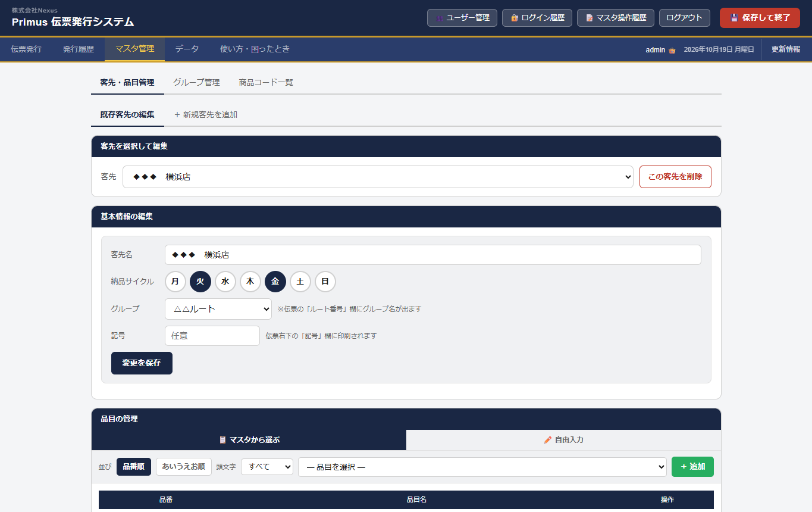

| 項目 | 説明 |
|---|---|
| 客先名 | 届け先の表示名 |
| 納品サイクル | 月〜日の丸ボタン。納品する曜日をON |
| グループ | 伝票の「ルート番号」欄に、このグループ名が出る |
| 記号 | 伝票の「記号」欄に印刷（任意） |
| 変更を保存 | ここを押さないと基本情報は反映されない |
| この客先を削除 | 客先ごと削除（慎重に） |

※締め日・配送費などは「請求系マスタ項目」がONのときだけ出ます。伝票だけ使うならOFFのままでOK。  
※伝票右下の会社名・住所・TEL／FAX／メール／ホームページは **データ** タブの「伝票フッターの会社名」で変更します。

---

## 10. マスタ：品目の管理

同じ画面の下（またはスクロールした先）が品目です。

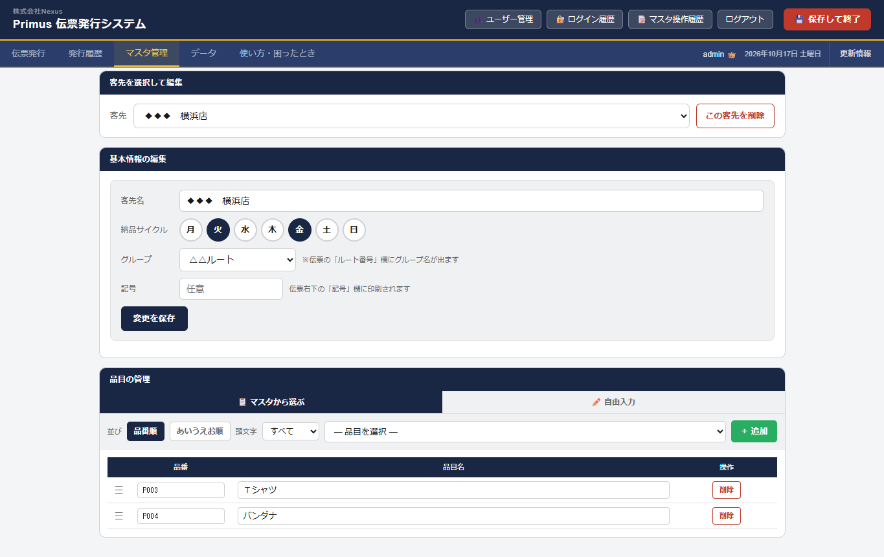

| 場所 | 説明 |
|---|---|
| マスタから選ぶ | 商品コード一覧にある品目を追加 |
| 自由入力 | その場で品名を入れて追加 |
| 並び（品番順／あいうえお） | 「マスタから選ぶ」一覧の並び |
| 頭文字 | あ・か・さ…／A・B・C… で絞り込み（漢字も読みで判定。例: 和帽子→わ） |
| 品番・品目名の一覧 | この客先の伝票に出る品目 |
| 削除 | この客先から品目を外す |
| 左の≡ | ドラッグで順番変更 |

**ポイント：** ここに登録した品目が、伝票発行の数量入力表に出ます。

---

## 11. マスタ：新規客先の追加

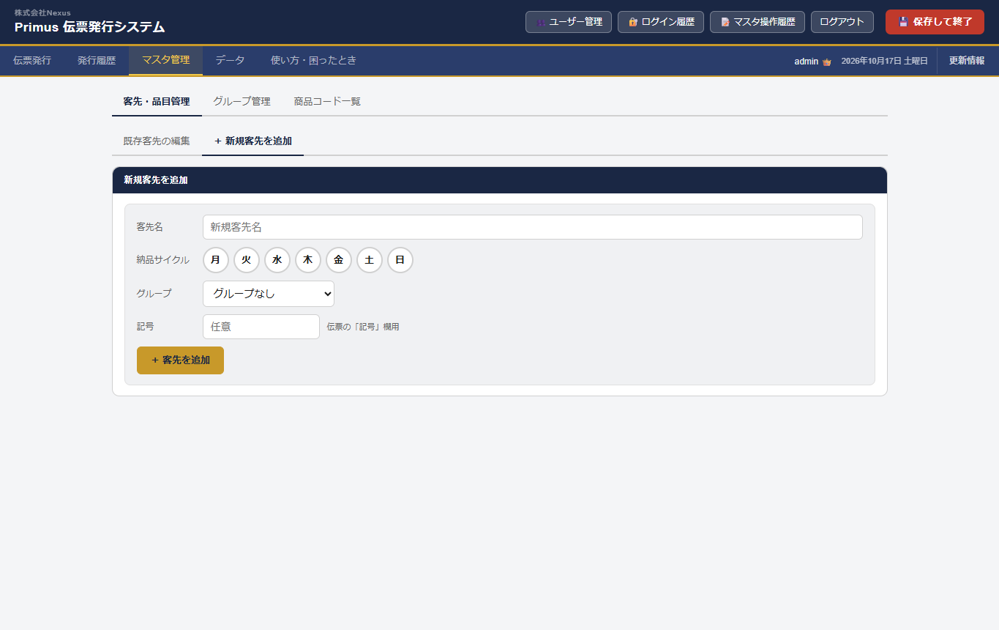

1. **＋ 新規客先を追加** を開く  
2. 客先名・納品サイクルを入れる  
3. 必要なら **グループ**（伝票のルート番号）と **記号** も入れる  
4. 追加する  
5. **既存客先の編集** に戻って品目を付ける  

客先だけ作っても、品目が無いと伝票入力で出すものがありません。

---

## 12. マスタ：商品コード一覧

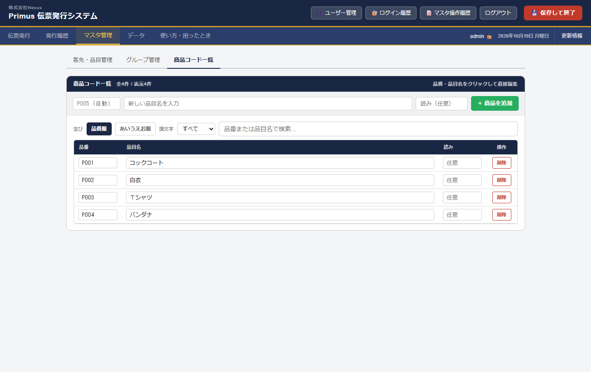

全社共通の品目マスタです。  
ここで登録しておくと、各客先の「マスタから選ぶ」で使えます。

| 操作 | 説明 |
|---|---|
| 新しい品目名を入力 → ＋商品を追加 | **品目名だけ入れればOK。品番は自動**（P001, P002…） |
| 読み（任意） | 頭文字絞り込み用。自動で合わないときだけひらがな等を入れる（例: わぼうし） |
| 品番欄 | 空のままで大丈夫。手入力もできるが、通常は自動で十分 |
| 並び／頭文字 | 品番順・あいうえお順と、頭文字プルダウンで一覧を絞れる |
| 一覧の品番・品目名・読み | クリックしてその場で編集できる |
| 検索 | 品番または品目名で絞り込み |

### 注意
- **すでに登録済みの品目（完全同名）を登録しようとすると、警告が出て追加できません。**  
  同じ名前を二重に増やさないための仕組みです。  
- 似た名前（表記ゆれ）は別物として登録できるので、名前の付け方はそろえると管理しやすいです。

---

## 13. データタブ

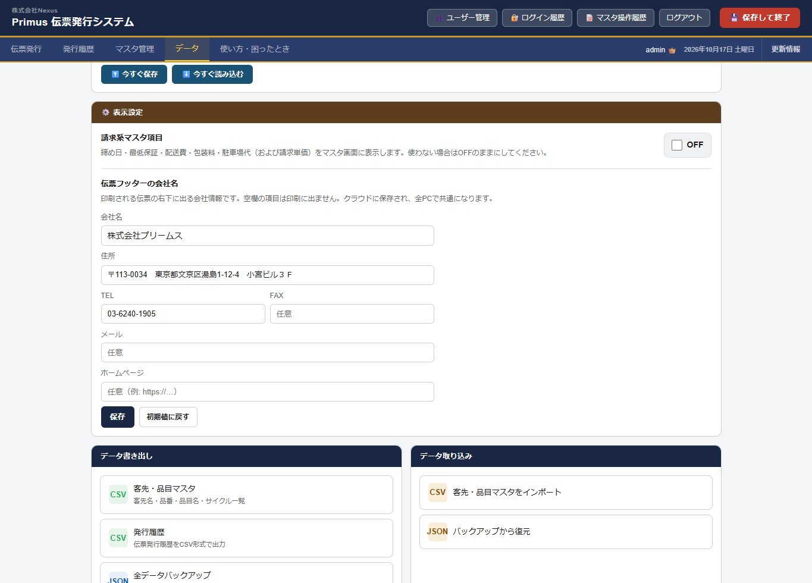

| 場所 | 説明 |
|---|---|
| 今すぐ保存／読み込む | 手動でクラウド同期 |
| 請求系マスタ項目 | ONにすると締め日などがマスタに出る（初期OFF） |
| 伝票フッターの会社名 | 会社名・住所・TEL／FAX／メール／ホームページ（空欄は印刷に出ない） |
| CSV書き出し | 客先・履歴の一覧出力 |
| JSONバックアップ | 緊急用の全データ退避 |
| 消えた客先を復元 | 履歴にあるのにマスタに無い客先を戻す |
| 取り込み | CSV／JSONから戻す |

おすすめ：週1で JSON バックアップをPCに保存。  
クラウド本体は導入当初は提供者側です。後日、御社の Firebase へ移す場合も、このJSONが移管・復旧の助けになります。

---

## 14. ユーザー管理（管理者と一般）

ユーザーの追加・削除は **管理者だけ** ができます。導入時に必ず決めておく大事な設定です。

### 管理者と一般ユーザーの違い

| | 管理者 | 一般ユーザー |
|---|---|---|
| 伝票発行・発行履歴・印刷 | ○ | ○ |
| マスタ管理（客先・品目） | ○ | ○（自分のログインパスワードで開く） |
| データタブ（保存・バックアップ） | ○ | ○ |
| **ユーザー管理ボタン** | ○（ヘッダーに表示） | ×（出ない） |
| ユーザーの追加・削除 | ○ | × |
| 管理者パスワードの変更 | ○ | × |
| ログイン履歴・マスタ操作履歴 | ○ | ○（見るだけ可） |
| 名前の表示 | 名前＋👑 | 名前のみ |

※ログイン用パスワードと、ユーザー管理に入るときの **管理者パスワード** は別物です。  
ユーザー管理を開くときは、管理者パスワードの再入力が必要です。

### 開き方

1. 管理者でログインする（名前の横に👑が出る）  
2. ヘッダーの **ユーザー管理** を押す  
3. 管理者パスワードを入力して **認証**

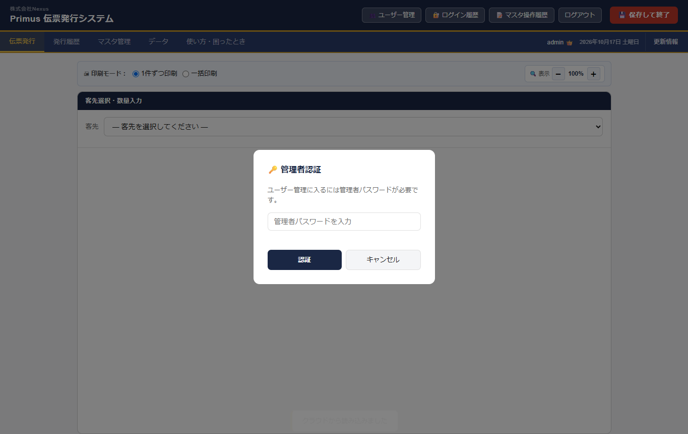

### ユーザー管理画面

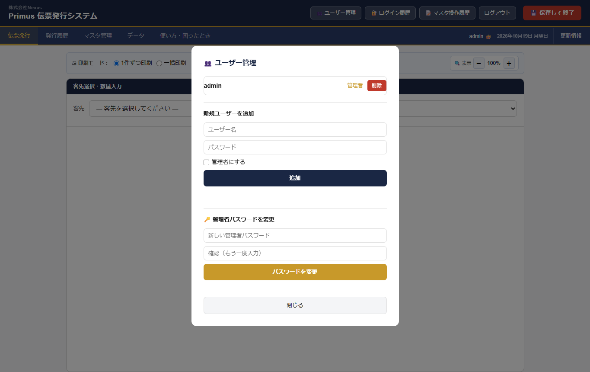

| 場所 | 説明 |
|---|---|
| ユーザー一覧 | 登録済みの人。管理者／一般の表示、削除ボタン |
| 新規ユーザーを追加 | ユーザー名・パスワードを入れる |
| 管理者にする | チェックすると管理者。外すと一般 |
| 追加 | 新しいログインを作る |
| 管理者パスワードを変更 | ユーザー管理に入るためのパスワードを変える |
| 閉じる | 画面を閉じる |

### 導入時のおすすめ
1. 管理者アカウントを1つ決める（社内の責任者）  
2. 現場で使う人は **一般** で作る  
3. 管理者パスワードは別紙やパスワード管理に控え、むやみに共有しない  
4. 人が増えたら管理者だけがユーザーを追加する  

### ログイン履歴

ヘッダーの **ログイン履歴** で、誰がいつログインしたかを確認できます（管理者・一般どちらも閲覧可）。

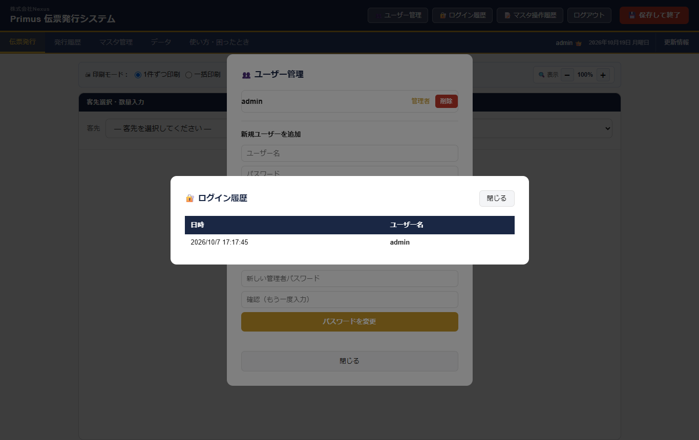

### 注意
- 自分自身は削除できません  
- 一般ユーザーには「ユーザー管理」ボタン自体が出ません  
- パスワードを忘れたら、管理者がユーザーを作り直す／管理者パスワードで管理画面に入って対応します  

---

## 15. 使い方タブ

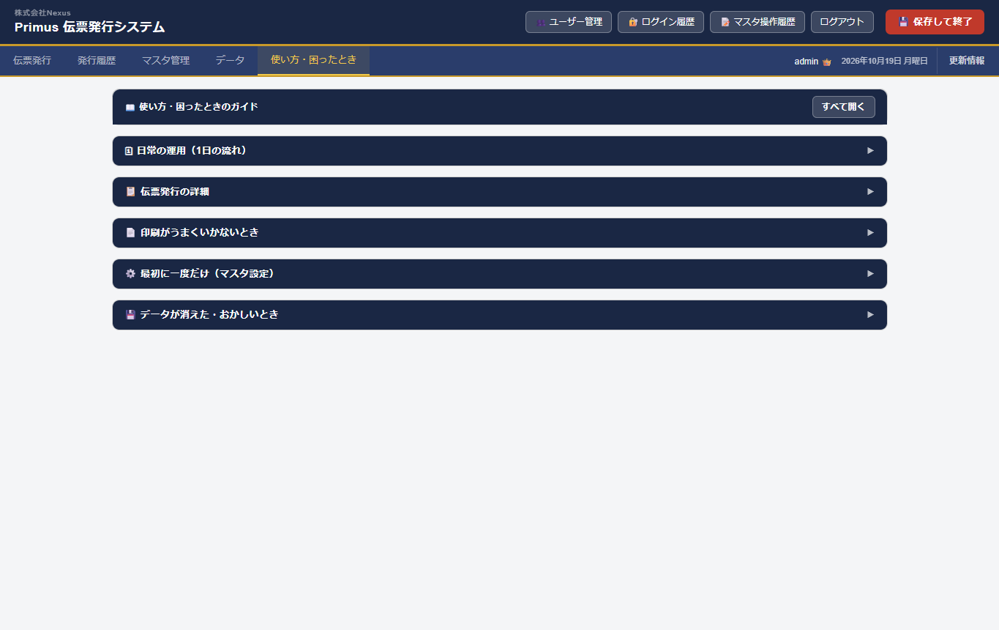

迷ったらアプリ内のここを開きます。日常の流れ・印刷トラブル・マスタの注意がまとまっています。  
各見出しは **最初は閉じて** います。知りたいところだけクリックして開いてください（「すべて開く」もあります）。

---

## 16. 日常の運用（1日の流れ）

1. ログイン  
2. **伝票発行** で客先を選ぶ  
3. 数量入力  
4. **伝票発行** → 印刷  
5. 出さない店は **飛ばす**（一括モード時）  
6. 終わり前に **発行履歴** を確認  

---

## 17. 印刷で困ったとき

| 症状 | 対処 |
|---|---|
| 小さく出る | 倍率 **100%** |
| 余白が大きい | 余白 **なし／最小** |
| 用紙が違う | **B5・横向き** |
| ルート番号が出ない／違う | 客先の **グループ** を確認（未設定なら空欄） |
| 記号が出ない／違う | 客先マスタの **記号** 欄を確認 |
| 会社名・TELなどが違う | **データ** →「伝票フッターの会社名」で保存（空欄の項目は印刷に出ない） |

---

## 18. サポート

期間中（月額サポート対象）に連絡してよいこと：

- 操作が分からない  
- 画面・印刷の不具合（再現手順があると助かります）  
- 軽い運用相談  

別見積：

- 大きな機能追加  
- 伝票レイアウトの大幅変更  
- 見積書・領収書の追加  

連絡先：株式会社プゥル・ヴー　担当 善方　TEL 046-267-9228　mobile 090-2906-8227

---

## 19. 導入完了のサイン（任意）

| 確認項目 | 確認 |
|---|---|
| URL・ログインが使える | □ |
| 管理者／一般の違いが分かった | □ |
| ユーザーを追加できた（管理者） | □ |
| 伝票入力のやり方が分かった | □ |
| マスタ登録のやり方が分かった | □ |
| テスト発行・印刷ができた | □ |
| 訂正再発行・同一納品日ロックが分かった | □ |
| ロット番号・台帳からの受け渡しが分かった | □ |
| （使う場合）請求タブの見方が分かった | □ |
| このガイドを受け取った | □ |

日付：　　年　　月　　日  
利用者側：　　　　　　　　　提供者側：　　　　　　　　
